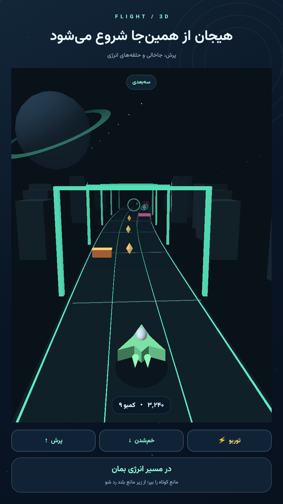
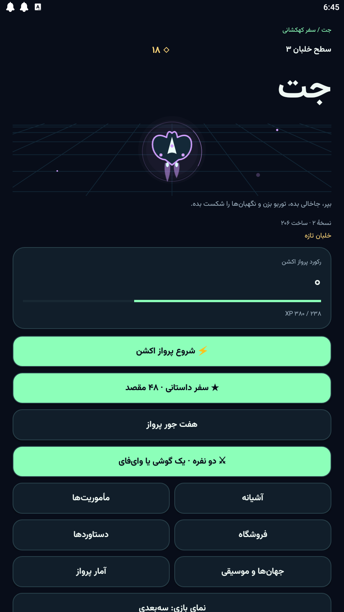
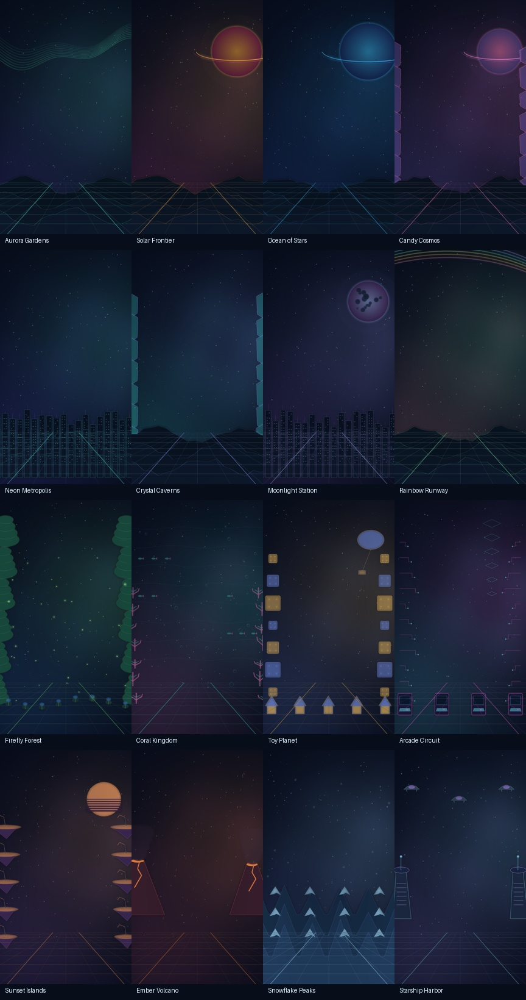

# JET — Android Arcade Game for Sale

**Complete version-2 game project available for a one-time acquisition.**

Native Java Android flight arcade game with OpenGL ES 2.0 and Canvas rendering, 48 campaign stages, local multiplayer, 16 illustrated environments and a reproducible original soundtrack.

**Version:** 2.0.0 · **Build:** 206 · **Platform:** Android 7.0+ · **Price:** offers invited

[Discuss an acquisition](https://github.com/ParsaBayat2014/JET-Game-For-Sale/issues/new?template=buyer-inquiry.yml) · [Buyer information](BUYER-FAQ.md) · [Listing copy](LISTING.md)

## See the game

<table>
<tr><td align="center"> 3D action — curated promotional scene</td><td align="center"> Actual build-206 menu</td></tr>
</table>

The action image uses the game's Android renderer and assets in a staged promotional layout; it is not an unmodified live gameplay capture. The menu image is an actual build-206 capture. Current artwork and captures include Persian text.

## What is already built

- 100-second Action Flight: steer between lanes, jump, duck, collect fuel and activate Turbo.
- 48 campaign stages across 12 chapters; Survival, Sprint, Daily Circuit, Energy Rush and Zen modes.
- GLES2 3D and Canvas 2.5D rendering, with a lighter rendering fallback.
- Same-phone competition and cooperative modes; two-phone local Wi-Fi score duel.
- 36 characters, including 28 earned characters and 8 optional paid cosmetics; 12 earned trails.
- 16 illustrated environments and 12 original synthesized soundtrack compositions, approximately 22 minutes 47 seconds in total.
- Persian/English localization support, high contrast, reduced motion and adaptive controls.
- Existing Myket cosmetic billing integration. No game advertising or analytics system is implemented.

Solo and same-phone play work offline. Nearby two-phone play requires a shared local network. There is no online matchmaking or Bluetooth mode. Version-3 Guardian Rush and network action/co-op are outside this sale package.

## Acquisition package

| Included in the proposed transaction | Details |
| --- | --- |
| Version-2 source | Private native Android project, tests and build scripts |
| Build documentation | JDK 17, Android SDK 34, Gradle wrapper and setup instructions |
| Media and generator source | Illustrated worlds, effects, fonts with licenses, and deterministic soundtrack generator |
| Existing APK | Build-206 signed Android APK available for a separately arranged evaluation; not a public download on this page |
| Transferable seller-owned rights | Exact rights, scope, deliverables and handover agreed in a written asset purchase agreement |

The intended deal is a **single full-project acquisition**, rather than a publishing/revenue-share arrangement or repeated sales of the same exclusive rights. Existing CC0 media and third-party open licenses remain non-exclusive; ownership of those underlying works cannot be sold as exclusive. The public showcase contains no game source code or signing credentials.

## Verification and commercial status

- 128 unit tests passed, with zero failures or errors; debug lint passed during preparation of the version-2 source repository.
- All 12 regenerated soundtrack WAVs matched the original build-206 SHA-256 checksums byte-for-byte.
- No verified revenue, active-user, installation or profit figures are represented in this listing. The offer is for a game project, not a proven income stream.
- End-to-end Myket purchases and multiplayer on two physical phones remain unverified. Google Play billing and a Google Play release are not included.
- The earlier Myket listing was deactivated for title/metadata changes. Reinstatement and transfer of a store listing are not promised.
- No gameplay video is published on this page yet. Screenshots have the provenance stated above.

## Buyer enquiries

[Open an acquisition enquiry](https://github.com/ParsaBayat2014/JET-Game-For-Sale/issues/new?template=buyer-inquiry.yml) with your intended use and questions. GitHub enquiries are public: keep payment details and confidential information out of them.

Demo access, private source review, buyer/seller eligibility, settlement method, final price, support scope and handover are agreed before a transaction. Sharing this page or opening an enquiry does not conclude a sale or transfer rights. The game's current in-app name is JET; any rebrand is a separate change.
